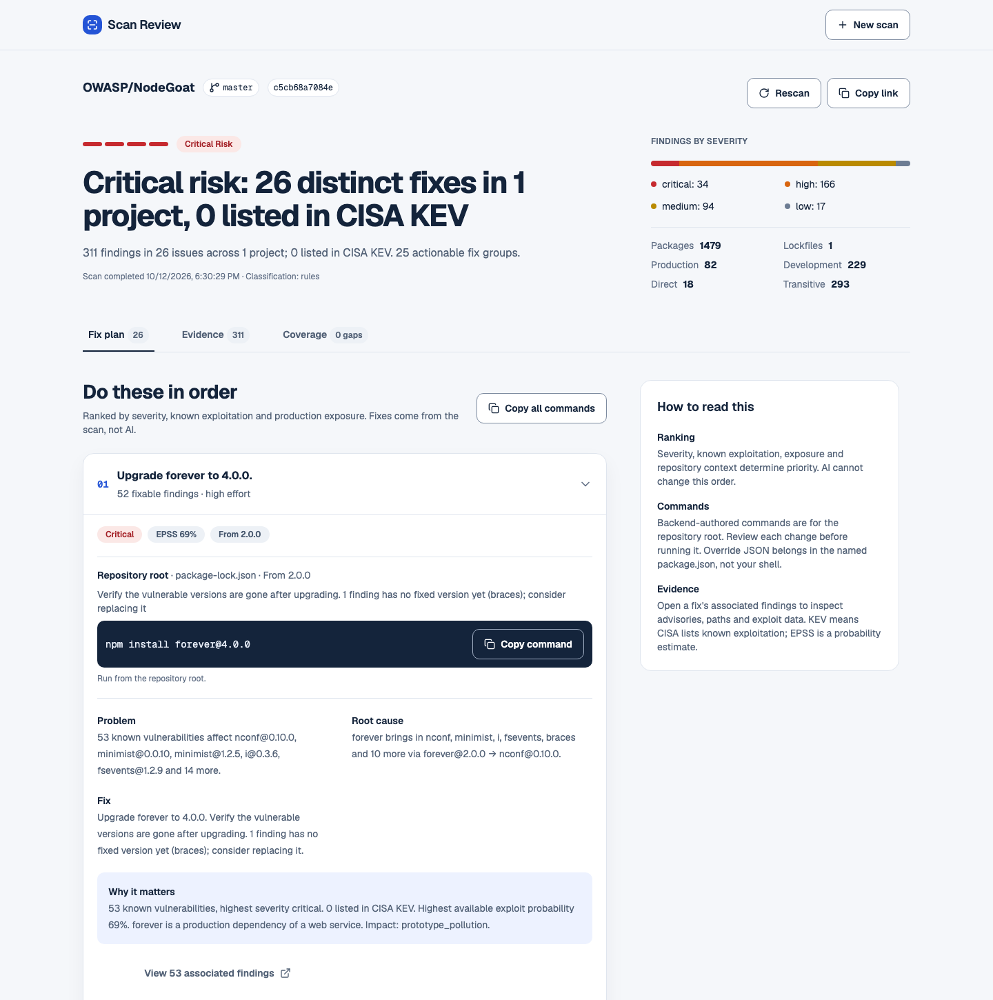
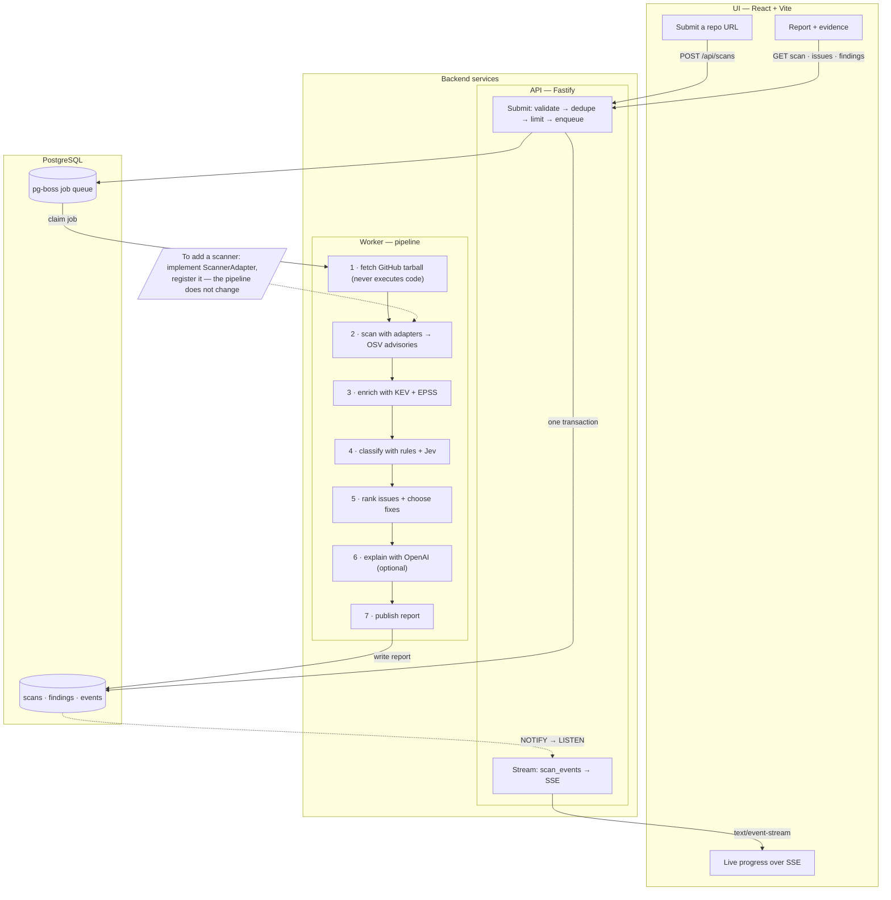

# Scan Review

**Know what to fix first.** Paste a public GitHub repo, get an ordered npm fix plan.

- Scans one commit snapshot — never installs or runs repo code
- Lockfiles → OSV advisories → exploit data (CISA KEV, FIRST EPSS)
- Findings grouped by root-cause Issue with concrete `npm` fix commands, ranked by real risk
- Live progress over SSE; reports link the exact commit
- Optional AI explanations and classification refinement — both degrade gracefully to templates/rules

## Run

Requires Node.js ≥ 22.18 and Docker with Compose.

**API keys are recommended.** Copy `.env.example` to `.env` and configure:

- `GITHUB_TOKEN` — higher GitHub API limits.
- `OPENAI_API_KEY` — AI-generated explanations.
- `TYPESAFE_API_KEY` — enhanced repository and vulnerability classification.

Docker Compose loads these automatically. Without keys, scans still work with lower GitHub limits and template/rule-based fallbacks.

**Start Docker first**, then run from the project root:

```sh
npm run start:docker
```

This builds the app, starts PostgreSQL, applies database migrations, and starts the API, worker, and UI. Open **<http://localhost:8080>**. No separate dependency installation or database setup is required.

- Ports **8080** and **5433** must be available.
- If Docker is missing or not running, the command fails with an error in the terminal.
- Press **Ctrl+C** to stop. Saved reports remain in the database volume.

## Demo

1. Open <http://localhost:8080> and submit `https://github.com/OWASP/NodeGoat`.
2. Follow live progress through dependency scanning, enrichment, and report generation.
3. Review the ordered **Fix plan**, inspect the supporting **Evidence**, and check **Coverage** for missing data.

A verified run produced a critical-risk report with 311 findings grouped into 26 issues. Results vary as the repository and advisory data change.



## Architecture



- The API and worker share one Postgres: the API enqueues the job in the same transaction as the scan row, workers claim jobs from pg-boss, and progress flows back via `NOTIFY` → SSE.
- New scanner: implement `ScannerAdapter` and register it in `scanner-registry.ts` — the pipeline does not change.
- New pipeline step: add it to `pipeline-stages.ts`.
- New API surface: a route plugin in `src/api/` plus a Zod schema; new UI screen under `web/src/features/`.
- Swap a provider (classifier, explainer): replace the `src/analysis/` module behind its function boundary.

## Key trade-offs

- **Public GitHub + npm only:** Keeps the flow focused and avoids authentication and multi-ecosystem complexity. Private repositories and other lockfile formats are out of scope.
- **Durable jobs:** PostgreSQL and pg-boss preserve work across restarts and make scan creation/enqueue atomic, at the cost of requiring a database.
- **Optional AI:** Adds explanations and context refinement, with latency and provider costs. Templates and rules keep scans useful without keys or during outages; AI does not generate scanner findings or fix commands.

## Future improvements

- **Observability:** Add distributed tracing and alerts for queue age, stage failures, and provider latency.
- **Evals:** Maintain a versioned benchmark for finding accuracy, prioritization, and AI explanation factuality.
- **Concurrency:** Enforce global and per-client admission limits atomically across API instances.
- **Scaling:** Load-test independent API/worker scaling; tune database pools and upstream rate-limit budgets.

## Develop

Local development: `docker compose up -d db`, `npm ci`, then `npm run dev` and `npm run dev:web` in separate terminals (UI on <http://localhost:5174>).

- `npm test` · `npm run typecheck` · `npm run format:check`
- `npm run build`, then `npm run test:integration` (needs `db` up)
- `npm run test:web` (`npx playwright install chromium` once)

## Learn more

- [How scanning and ranking work](docs/SCANNING.md) — pipeline, scoring formula, fix ladder
- [Operations](docs/OPERATIONS.md) — env vars, queue/roles, idempotency, limits, security model
- [How I used coding agents](docs/AGENT_USAGES.md) — planning, implementation, and iterative review
