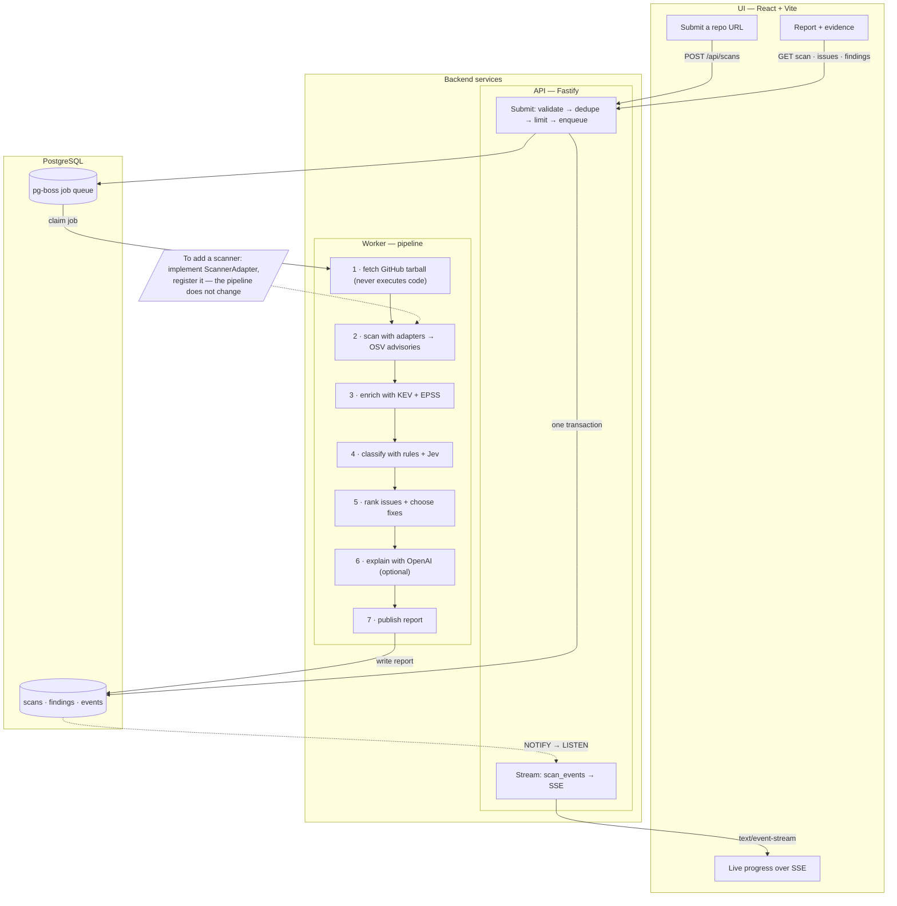

# Scan Review

**Know what to fix first.** Paste a public GitHub repo, get an ordered npm fix plan.

- Scans one commit snapshot — never installs or runs repo code
- Lockfiles → OSV advisories → exploit data (CISA KEV, FIRST EPSS)
- Findings grouped by root-cause Issue with concrete `npm` fix commands, ranked by real risk
- Live progress over SSE; reports link the exact commit
- Optional AI explanations and classification refinement — both degrade gracefully to templates/rules

## Architecture

- The API and worker share one Postgres: the API enqueues the job in the same transaction as the scan row, workers claim jobs from pg-boss, and progress flows back via `NOTIFY` → SSE.
- New scanner: implement `ScannerAdapter` and register it in `scanner-registry.ts` — the pipeline does not change.
- New pipeline step: add it to `pipeline-stages.ts`.
- New API surface: a route plugin in `src/api/` plus a Zod schema; new UI screen under `web/src/features/`.
- Swap a provider (classifier, explainer): replace the `src/analysis/` module behind its function boundary.

## Run it

- `docker compose up --build` → <http://localhost:8080> (Postgres on 5433)
- Dev: `docker compose up -d db`, `npm install`, then `npm run dev` + `npm run dev:web` (UI on :5174)
- Needs Docker and Node ≥ 22.18; no tokens required (60 GitHub req/h without one)

## Develop

- `npm test` · `npm run typecheck` · `npm run format:check`
- `npm run build`, then `npm run test:integration` (needs `db` up)
- `npm run test:web` (`npx playwright install chromium` once)

## Learn more

- [How scanning and ranking work](docs/SCANNING.md) — pipeline, scoring formula, fix ladder
- [Operations](docs/OPERATIONS.md) — env vars, queue/roles, idempotency, limits, security model
- [Contributing](docs/CONTRIBUTING.md) — tests, module map, conventions
- [Product contract](docs/DESIGN.md) / [visual design](docs/design.html) — requirements and targets
